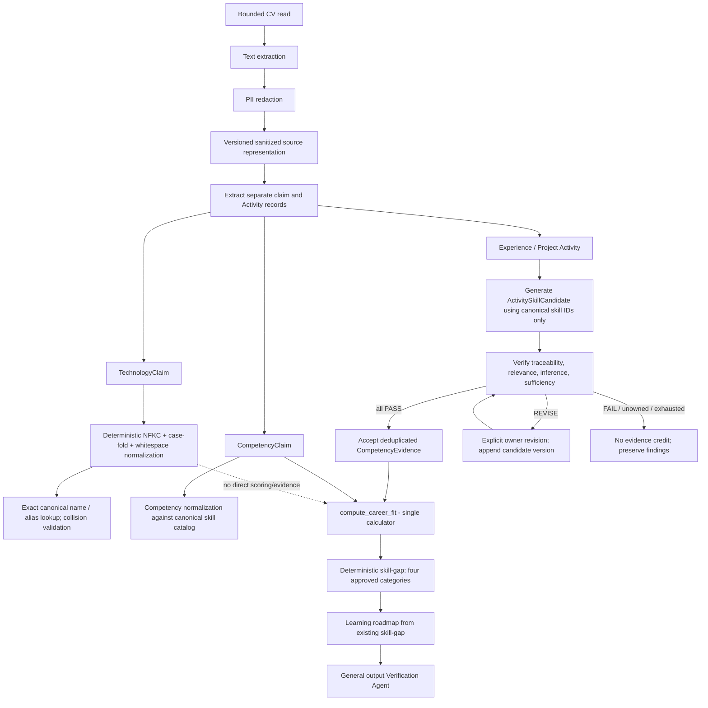

# T3 Data Model and Pipeline Contract

**Status: T3 COMPLETE — CONTRACT AND OPEN-DESIGN TRADE-OFFS APPROVED**
**Scope:** Conceptual and field-level design only. This document does not authorize or perform source, prompt, schema, migration, database, or runtime changes.
**Controlling baseline:** `docs/design-freeze.md`, the T1 decisions in `docs/evaluation/DECISIONS.md`, `docs/evaluation/EXPERIMENT_SPEC.md`, and the repository-level findings in `docs/audits/T2_IMPLEMENTATION_AUDIT.md`.

## 1. Design Principles and Invariants

1. Keep user claims, technologies, source Activities, candidate Activity–Skill relations, accepted evidence, and occupational records conceptually separate.
2. Preserve original extracted values and source traceability. Persist only sanitized values; do not retain raw PII merely to support auditability.
3. Use canonical OKB IDs only when they exist in the relevant catalog. Unknown claims remain unmatched; candidates cannot introduce new skill IDs.
4. Technology recognition and technology-to-competency context never by themselves create a CompetencyClaim or CompetencyEvidence and never directly affect career fit or skill-gap.
5. Only an Activity–Skill candidate whose overall verification status is `PASS` can create activity-derived CompetencyEvidence. `REVISE` and `FAIL` earn no evidence credit.
6. Non-activity evidence (including self-report, education, and certification records) remains unaccepted for `matched_evidenced` unless a separately approved verification mechanism is defined.
7. Preserve `compute_career_fit()` as the sole fit calculator and retain exactly `matched_evidenced`, `matched_claimed_only`, `missing`, and `unmatched_user_claims`.
8. A single Activity may be considered for multiple canonical skills only as separate independently verified Activity–Skill relations. This is the recommended interpretation of T1's relation-level verification and remains subject to researcher confirmation in §12.
9. Verification records findings; it does not rewrite candidates or upstream outputs. Revisions are explicit, bounded, owner-routed, append-only, and re-verified.
10. Do not assume live database schema, OKB catalog contents, or workbook/database parity. Those are T4 verification matters.

## 2. Conceptual Entities

| Entity | Purpose | T1 status |
|---|---|---|
| `TechnologyClaim` | A technology term extracted from a source, independently normalized against the OKB technology catalog and aliases. | Approved concept; exact identity/source storage details specified here as a proposal. |
| `CompetencyClaim` | An explicit competency assertion extracted from a source, normalized to a canonical OKB skill when possible. | Approved concept; no accepted evidence is implied by a match. |
| `Activity` | A sanitized Experience or Project source record usable as evidence context. | Approved concept; it is not itself accepted competency evidence. |
| `ActivitySkillCandidate` | One proposed relation between an Activity and an existing canonical skill, with immutable candidate versions and verification attempts. | Approved concept; one relation is independently checked. |
| `CandidateVersion` | An immutable snapshot of candidate content and generation/revision provenance. | Required to preserve originals and revisions; detailed shape proposed here. |
| `VerificationFinding` | A dimension-level result and rationale for one verification attempt of one candidate version. | Approved verification contract; exact serialization proposed below. |
| `CompetencyEvidence` | An accepted evidence credit for one canonical skill from one Activity–Skill relation. | Approved only when the relation's overall verification is `PASS`. |
| `SourceDocument` (conceptual reference) | Identifies one sanitized extraction input/version and supports stable source references without retaining raw CV bytes. | Supporting identity concept; retaining a full redacted document is not decided. |

These are conceptual records, not assertions about physical table names or current database structure.

## 3. Proposed Field-Level Data Contracts

Field types are conceptual. Database types, API serialization, encryption/retention, and exact index definitions are implementation details for later design and T4/T5 review.

### 3.1 Shared source and extraction provenance

| Field | Contract |
|---|---|
| `profile_id` | Owning profile identifier; required on user-originated claims, Activities, candidates, and evidence. |
| `source_document_id` | Stable identifier for one submitted source version; nullable only for already-structured legacy profile records without a recoverable document. |
| `source_document_fingerprint` | Fingerprint of a deterministic representation of the redacted extracted text, not the raw upload; used for exact reprocessing identity, not as proof of document authenticity. A plain content hash can still be linkable/sensitive; keyed fingerprinting or an ingestion-issued stable ID needs a privacy/operations decision. |
| `redaction_version`, `text_representation_version` | Identify the redaction and canonical text representation used for excerpts/locators; a change creates a distinct source version unless explicitly reconciled. |
| `source_type`, `source_metadata` | Supported source kind and non-sensitive document metadata needed for traceability; do not retain raw document bytes in this contract. |
| `source_reference` | Typed locator resolving to a sanitized source record: source type, source record ID and, when available, section and span. Must not contain raw CV text or PII. |
| `source_section` | Controlled label such as `skills`, `experience`, `projects`, `education`, `certifications`, or `unknown`; it records extracted context, not independently verified truth. |
| `source_excerpt` | Exact extracted surface text after PII redaction, retained only where needed for the claim/activity/candidate audit trail. It is not normalized or paraphrased. |
| `source_locator` | Optional start-inclusive/end-exclusive Unicode code-point offsets into the exact redacted extracted-text representation plus a representation/version identifier. No offset is populated unless upstream extraction/redaction can reliably produce and preserve it. |
| `extraction_run_id` | Identifies the extraction attempt; supports diagnostics and repeated-run lineage, not entity identity by itself. |
| `extractor_version` | Version or revision of the text extractor/sectioning logic. |
| `extractor_model_id`, `prompt_hash` | Model and prompt identity when LLM extraction was used; omit or mark not applicable for deterministic-only operations. |
| `created_at` | Record creation time. A timestamp is audit metadata, not a stable key. |

### 3.2 `TechnologyClaim`

| Field | Contract |
|---|---|
| `technology_claim_id` | Stable ID for one source claim. Recommended identity: source-document ID plus exact source locator and claim kind; fallback identity must be reviewed if no locator exists. |
| `profile_id` | Owning profile. |
| `source_reference`, `source_section`, `source_excerpt` | Sanitized trace to the exact source mention. |
| `surface_term` | Original extracted technology mention after redaction; never overwritten by normalization. |
| `normalized_value` | NFKC, case-folded, whitespace-normalized matching value. Keep the surface term separately. |
| `technology_id` | Nullable canonical technology ID from the actual OKB technology catalog. Never fabricate. |
| `match_status` | Exactly `matched` or `unmatched`; catalog alias collisions are validation errors, not an arbitrary winner. |
| `match_method` | Audit value such as `canonical_exact`, `alias_exact`, or `unmatched`; not a confidence score. |
| `catalog_fingerprint` | Fingerprint of the catalog snapshot used for resolution, when available. |
| `extraction_provenance` | Shared extraction provenance plus the claim extractor version. |

Technology aliases are matched using the approved NFKC/case-fold/whitespace normalization followed by exact lookup. Fuzzy technology-ID assignment is prohibited. A technology claim is never a skill claim or evidence by coercion.

### 3.3 `CompetencyClaim`

| Field | Contract |
|---|---|
| `competency_claim_id` | Stable ID for one source claim. Recommended identity: source-document ID plus exact source locator and claim kind; fallback identity requires approval. |
| `profile_id` | Owning profile. |
| `source_reference`, `source_section`, `source_excerpt` | Sanitized trace to the explicit claim. |
| `surface_term` | Original extracted competency wording after redaction; never overwritten by canonicalization. |
| `normalized_value` | Deterministically normalized comparison value, retained separately from the surface term. |
| `skill_id` | Nullable canonical OKB skill ID. Unknown or ambiguous claims must not be assigned a fabricated ID. |
| `match_status` | T1's approved `matched` or `unmatched`. If the existing matcher cannot safely resolve a claim, use `unmatched` and retain the reason/method rather than adding a fifth skill-gap category. |
| `match_method` | Exact, fuzzy, or validated LLM-assisted method identifier, as applicable to the existing normalizer; record the actual method and catalog fingerprint. |
| `extraction_provenance` | Shared extraction provenance. |
| `evidence_state` | Derived presentation value only: `unaccepted` unless accepted Activity-derived evidence exists. It must not be upgraded by the claim's match status or by a generic legacy evidence row. |

This entity represents an explicit claim, not proof of competency. A matched claim without accepted evidence remains eligible for `matched_claimed_only`; unmatched claims remain in `unmatched_user_claims`.

### 3.4 `Activity`

| Field | Contract |
|---|---|
| `activity_id` | Stable ID for one source Activity. Recommended source identity is in §6; researcher approval is required. |
| `profile_id` | Owning profile. |
| `activity_type` | Exactly `experience` or `project`. |
| `source_type` | Existing record kind or upload/source kind; distinct from the skill being inferred. |
| `source_record_id` | Existing `experience_id` or `project_id` when the source has been persisted and the ID is retained by the extraction flow. |
| `source_document_id` | Source-document version when derived from a CV. |
| `source_section` | Section identity, when reliably available. |
| `source_excerpt` | Sanitized, exact extracted Experience/Project text required to support source review. It is immutable for a given Activity version. |
| `source_locator` | Optional reliable locator into a versioned redacted text representation. Do not synthesize offsets from a model summary. |
| `activity_fingerprint` | Fingerprint of source identity and sanitized Activity content used for idempotent extraction; not a semantic similarity score. |
| `extraction_provenance` | Shared provenance, including which extraction run first created the immutable source record. |
| `supersedes_activity_id` | Optional explicit lineage when a researcher/user links a changed-source Activity to an earlier one; never auto-populated by fuzzy similarity. |
| `lifecycle_status` | Proposed values: `active`, `superseded`, `withdrawn`. A superseded or withdrawn Activity cannot silently earn new evidence. |

Do not treat role title, employer, project title, or technology list as sufficient competency evidence by themselves.

### 3.5 `ActivitySkillCandidate`

| Field | Contract |
|---|---|
| `candidate_id` | Stable identity for one Activity–canonical Skill pair; recommended deterministic key derived from `activity_id` and `skill_id` (§6). |
| `profile_id` | Owning profile; must agree with the Activity. |
| `activity_id` | Required existing Activity ID. |
| `skill_id` | Required existing canonical OKB skill ID. Reject a candidate if this ID does not resolve in the pinned catalog. |
| `current_version` | Monotonic version number for the current candidate content. |
| `lifecycle_status` | Proposed values: `pending_verification`, `pass`, `revise`, `fail`, `withdrawn`, `superseded`. Only `pass` may be accepted, and only for the exact verified version. |
| `created_at`, `updated_at` | Audit timestamps; never identity keys. |

Candidate identity is stable for the Activity–Skill pair; candidate content is stored in immutable versions. A retry or revision appends a version; it does not overwrite the original candidate or previous findings. Verification attempts and revisions are defined in §8.

### 3.6 `CandidateVersion`

| Field | Contract |
|---|---|
| `candidate_version_id` | Stable ID for one immutable candidate content version. |
| `candidate_id` | Parent Activity–Skill candidate identity. |
| `version_number` | Monotonic integer within the candidate, starting at 1. |
| `candidate_text` | Exact sanitized source excerpt/context used for this candidate version; changes require a new version. |
| `generation_method`, `generator_version`, `model_id`, `prompt_hash` | Candidate-generation provenance for this version. |
| `catalog_fingerprint` | OKB snapshot used to validate the candidate's canonical skill ID. |
| `created_from_version_id` | Nullable prior version for an explicit revision; absent for version 1. |
| `revision_instruction` | The explicit owner instruction that led to this version, if revised. |
| `created_at` | Creation time; not an identity key. |

`ActivitySkillCandidate.current_version` points to the latest version for display/processing. Earlier versions and all their findings remain immutable.

### 3.7 `VerificationFinding`

| Field | Contract |
|---|---|
| `verification_attempt_id` | Stable ID for one full verification attempt. |
| `candidate_id`, `candidate_version` | Exact candidate version under review. |
| `check_name` | Exactly `traceability`, `semantic_relevance`, `inference_validity`, or `evidence_sufficiency`. |
| `status` | `PASS`, `REVISE`, or `FAIL` for that check. |
| `reason` | Concise, evidence-grounded explanation. |
| `source_reference` | Sanitized source locator or candidate/activity reference supporting the finding; no invented citation. |
| `responsible_owner` | Component/role responsible for an allowed revision, or null when no safe owner exists. |
| `revision_instruction` | Explicit, bounded instruction naming fields that may change; required for a routed REVISE, absent for PASS/FAIL. |
| `verifier_version` | Deterministic rule/model/version provenance. |
| `created_at` | Attempt timestamp. |

Overall attempt status is stored once per attempt and follows §8. Findings are append-only and never silently replaced.

### 3.8 `CompetencyEvidence`

| Field | Contract |
|---|---|
| `competency_evidence_id` | Stable idempotency key derived from accepted source identity and canonical skill; exact formula depends on the approved source-locator decision. |
| `profile_id` | Owning profile. |
| `activity_id` | Required originating Activity. |
| `skill_id` | Required canonical OKB skill ID. |
| `candidate_id`, `candidate_version` | Exact relation/version accepted. |
| `verification_attempt_id` | Required attempt whose overall result is `PASS`. |
| `source_reference`, `source_excerpt` | Sanitized and resolvable Activity evidence pointer. |
| `acceptance_status` | `accepted`; a record may be created only after the referenced attempt is PASS and still refers to the current candidate version. |
| `deduplication_key` | Pair key plus source-excerpt identity as specified in §6. |
| `created_at` | Acceptance time. |

No evidence row is created for REVISE, FAIL, unowned findings, exhausted revisions, or non-activity records. A later source/candidate revision does not rewrite an earlier evidence record; its validity/revocation policy needs approval if the source is withdrawn.

## 4. Entity Relationships

```text
Profile 1 ── * SourceDocument
Profile 1 ── * TechnologyClaim
Profile 1 ── * CompetencyClaim
Profile 1 ── * Activity
Activity 1 ── * ActivitySkillCandidate (one candidate per canonical skill)
Canonical Skill 1 ── * ActivitySkillCandidate
ActivitySkillCandidate 1 ── * CandidateVersion
CandidateVersion 1 ── * VerificationAttempt
VerificationAttempt 1 ── 4 VerificationFinding records (one per check)
PASS VerificationAttempt ── 0..1 accepted CompetencyEvidence per deduplication key
Activity 1 ── * CompetencyEvidence
Canonical Skill 1 ── * CompetencyEvidence
```

The diagram is conceptual. The actual OKB and runtime schema must be verified before selecting concrete foreign keys or constraints.

## 5. Lifecycle and State Transitions

### Claims and Activities

- Extract a source claim/activity from redacted text and preserve its original surface value and source provenance.
- Normalize a claim without replacing the original. A claim's matching status does not make it verified evidence.
- Create or reuse an Activity only through the approved identity/idempotency rule. Changed input is a new immutable extraction version unless an explicit lineage decision links it.
- A technology claim terminates in `matched`/`unmatched` technology space; it does not transition into competency evidence.

### Activity–Skill candidate

```text
candidate generated (pending_verification)
  ├─ all four checks PASS ─> pass ─> eligible for evidence acceptance
  ├─ any check FAIL ───────> fail ─> no evidence
  └─ no FAIL and >=1 REVISE > revise ─> explicit owner revision or terminal no-credit
                                           └─ append new version, re-run all checks
```

`withdrawn`/`superseded` candidates are terminal for new acceptance. The initial candidate and every verification attempt remain available for audit. A revised candidate is not the same immutable version as the original.

### Evidence

An accepted evidence record is created only for a PASS on the exact candidate version, after canonical skill and source-reference validation. Acceptance is idempotent. A duplicate attempt returns/recognizes the existing credit rather than generating additional credit. No evidence is accepted from a generic evidence row by inference.

## 6. Deduplication and Idempotency Rules

### Approved T1 rules

- At most one accepted evidence credit per stable `(activity_id, skill_id)` pair.
- Reprocessing the same source Activity resolves to the same Activity identity.
- Distinct Activities may independently support the same canonical skill.
- Similar wording alone must not merge distinct Activities.
- Reuse of the same underlying source excerpt across Activity records must not create extra credit.

### Proposed keys (approval required where identified)

1. **Source version:** use an opaque persisted ingestion/source ID. Retries of the same persisted ingestion reuse that ID; a separate upload is a distinct source version, even if its content is identical. Do not hash raw upload bytes. This favors privacy and simple identity over cross-upload content deduplication.
2. **Activity identity:** recommended key `hash(profile_id, source_document_id, activity_type, stable_source_locator)`. When there is no reliable locator, use an existing persisted Experience/Project source-record ID only if extraction persistence is idempotent; otherwise do not silently deduplicate based on title/text similarity.
3. **Candidate identity:** recommended unique pair `(activity_id, canonical_skill_id)`. Candidate versions and verification attempts are append-only children of this pair.
4. **Evidence pair constraint:** unique `(profile_id, activity_id, skill_id)` ensures one accepted credit per Activity–Skill pair.
5. **Excerpt reuse constraint:** also require a canonical `source_excerpt_id` derived from `(source_document_id, source_locator, exact_sanitized_excerpt)` and unique `(profile_id, skill_id, source_excerpt_id)`. This prevents the same excerpt copied into two Activity records in the same source version from earning two credits. If exact sanitized excerpt text matches across distinct source versions but lineage cannot establish whether it was copied or independently written, do not merge the Activities or automatically award another credit; hold the additional credit for explicit duplicate/lineage resolution. If a reliable locator is unavailable, the excerpt-level constraint cannot be guaranteed; do not claim that it is.
6. **Changed CV:** exact reprocessing of the same sanitized source version is idempotent. A changed redacted document creates a new source version and new Activities by default. Cross-version matching/merging is explicit user/researcher lineage, never fuzzy auto-merge.
7. **Claim identity:** recommended key `(profile_id, source_document_id, source_locator, claim_kind)`. If the source locator is absent, repeat extraction may duplicate the claim; avoid merging distinct same-text claims without provenance.
8. **Acceptance replay:** repeated acceptance for the same candidate version/verification attempt and deduplication key returns the existing CompetencyEvidence; it does not create another credit.

**Important limitation:** the current CV extractor returns extracted text and basic metadata, but the inspected handoff does not preserve section offsets/source locators. The above source-locator-based keys require upstream extraction/redaction changes and cannot be implemented reliably by reconstructing offsets from the current persisted summaries.

## 7. Source Traceability and Redaction Design

1. Use the existing pipeline order: bounded file read → text extraction → PII redaction → structured claim/activity extraction. Raw upload bytes and pre-redaction extracted text must not be persisted by this contract.
2. Preserve `surface_term` and `source_excerpt` as exact **post-redaction** extracted text; keep normalized values separately. Do not describe a paraphrase or model-generated summary as the original text.
3. A source reference should resolve to a sanitized source record and include document/version identity, source type, record ID, section, and a reliable span when available.
4. Proposed spans are start-inclusive/end-exclusive Unicode code-point offsets against a versioned, canonical redacted text representation. Redaction and Unicode normalization can change offsets; therefore offsets must be generated against the final redacted representation and accompanied by its representation version/fingerprint.
5. Current CV extraction does not expose spans/section anchors and the profile agent does not retain those references. Do not fabricate them from generated fields. Add upstream provenance/section mapping before candidate generation.
6. Do not persist a full redacted CV by default. The preferred proposal is to retain only sanitized claim/activity excerpts plus a source-document fingerprint and locator. This has lower privacy exposure but limits later independent re-resolution when the source document is unavailable.
7. Alternative: retain a full redacted extracted-text artifact in access-controlled storage with an explicit retention/deletion policy. This improves reference resolution but increases privacy and data-governance obligations. Researcher approval is required; see §12.
8. Existing Experience/Project database IDs can be source record references only after the extraction flow retains the returned IDs. Current code calls persistence methods but does not use their returned IDs to construct evidence pointers (`backend/app/agents/profile_agent.py:100-112`).

## 8. Candidate Verification and Revision Protocol

Every candidate version is evaluated independently against its Activity and canonical skill.

| Check | PASS | REVISE | FAIL |
|---|---|---|---|
| `traceability` | Candidate Activity and excerpt resolve to the sanitized source record. | Locator is incomplete but a specific owner action could recover the reference. | Source is absent, contradictory, or cannot be resolved. |
| `semantic_relevance` | The activity's described action/output supports the canonical skill's meaning. | The source is potentially relevant but needs a bounded clarification. | The activity is unrelated to the skill. |
| `inference_validity` | Skill follows from the described action/output without title, tool-name, or general-assumption leaps. | The source may support the inference after explicit clarification. | The relation requires an unsupported inference. |
| `evidence_sufficiency` | Source describes an attributable concrete action or output, not merely a bare assertion/tool list. | A concrete action/output could be clarified by the responsible source/activity owner. | Evidence is absent or irrecoverably insufficient. |

**Overall aggregation (approved T1):**

- `PASS` iff all four checks are `PASS`.
- `FAIL` if any check is `FAIL`, even if another check is `REVISE`.
- `REVISE` iff no check is `FAIL` and at least one check is `REVISE`.
- Only overall `PASS` is eligible for CompetencyEvidence.

**Attempt/finding protocol:**

1. Persist one immutable candidate version and its generation provenance.
2. Persist all four dimension findings, including status, concise reason, source reference, verifier version, and responsible owner.
3. A `REVISE` finding may route only to the responsible candidate-producing component. The finding must include a concrete instruction limited to relevant fields. No verifier-side rewriting is permitted.
4. Preserve candidate version N and its findings. A revision appends version N+1, points to its predecessor, and triggers all four checks again. Prior findings remain immutable and are not overwritten.
5. `FAIL`, unowned `REVISE`, or exhausted revision budget is terminal for that run and grants no evidence credit. A later fresh extraction is a new run/version and cannot retroactively turn the earlier attempt into PASS.
6. Reverify after every revision; do not treat revision itself as acceptance.
7. Reuse the existing configurable workflow cap (`max_revisions`, currently default 2) rather than silently introducing a new number. The current workflow counts revisions at the analysis-run level; applying that global budget to multiple candidates may starve later candidates. The cap's scope must be approved in §12.
8. Preserve the existing general workflow and its stage routing where suitable. Candidate verification is a new relation-level lifecycle, not a reason to discard the general recommendation/gap/roadmap verifier.

## 9. Legacy Implementation Mapping

| Existing implementation | Mapping | Proposed treatment |
|---|---|---|
| `UserSkillOut` (`backend/app/schemas/user.py:65-82`) | Combines user claim fields with evidence status and evidence list; it has optional canonical skill ID but no claim source reference. | **Adapt** as a compatibility/read projection during transition. New claim identity, source, and normalization provenance belong to `CompetencyClaim`. Do not delete the schema or existing records as part of T3. |
| Generic `user_skill_evidence` rows (`backend/app/schemas/user.py:56-63`; `backend/app/repositories/user_repository.py:245-273`) | May represent self-report, project, education, certification, or other generic evidence; current rows need not resolve to an Activity or PASS candidate. | **Deprecate as authority for accepted activity evidence; retain** records and provenance for historical display/audit. No destructive deletion and no automatic conversion to `CompetencyEvidence`. |
| `evidence_status='linked'` (`backend/app/repositories/user_repository.py:265-269`; career-fit service) | Currently set after any generic evidence row and interpreted by career fit as fully evidenced. | **Adapt/deprecate as an independent truth source.** Future scored status must derive only from accepted PASS Activity–Skill evidence. Treat pre-existing `linked` as legacy/unverified and do not count it as accepted evidence absent explicit validation. Keep original values for audit until an approved migration/compatibility plan. |
| Existing Experience/Project records (`backend/app/schemas/user.py:29-49`; `backend/app/services/user_service.py:36-48`) | Structured source facts with record IDs, but current Profile Agent does not retain returned IDs for evidence linkage or source spans. | **Keep and adapt** as Activity source records; do not duplicate them into a second store until T3/T4 decides the mapping. Preserve original rows; add explicit source identity/linkage in a later approved implementation. |
| Existing `skill_normalizer.py` (`backend/app/agents/skill_normalizer.py:18-50`) | Normalizes competency-like text using exact, fuzzy, validated LLM-suggested ID, else unmatched. | **Adapt/reuse for CompetencyClaim normalization** with method/catalog provenance and test coverage. **Do not reuse for technology matching**; technology aliases require exact normalized lookup. Approval is required before changing its current fuzzy/LLM behavior. |
| General `VerificationAgent` (`backend/app/agents/verification_agent.py:148-679`) | Verifies recommendation, gap, roadmap, provenance, and generated text; it does not verify candidate evidence. | **Keep and extend/integrate** with relation-level candidate verification without changing its non-mutation invariant or replacing the four-check rubric with semantic LLM review alone. |
| Workflow revision loop (`backend/app/workflows/career_workflow.py:116-141, 311-453`) | Bounded general stage reruns with owner routing/re-verification; no feedback-taking agent API or candidate history. | **Keep and adapt** for explicit candidate owner instructions and append-only candidate versions. Preserve the existing configured cap; obtain approval on global-vs-per-candidate scope. |
| Existing `profile_agent.py` generic extraction/evidence persistence (`backend/app/agents/profile_agent.py:33-58, 86-154`) | Extracts one `skills[]` list and attaches generic evidence directly; it does not separate technology claims or gate evidence. | **Adapt** in T5 after contract approval. T3 does not authorize the code change. |

**Legacy `linked` alignment rule:** during future migration/alignment, do not delete legacy generic evidence. Preserve it as historical/unaccepted source information. A `linked` flag alone is insufficient to establish PASS, stable Activity identity, canonical Activity–Skill relation, or evidence deduplication; therefore it must not be grandfathered into accepted `matched_evidenced`. Any case-specific recovery would require traceable source mapping and the approved verification process, not bulk inference.

## 10. End-to-End Pipeline



`TechnologyClaim` is shown with a dotted non-scoring relationship to emphasize that recognition never enters career fit. The general output verifier is distinct from per-candidate evidence verification.

## 11. Deterministic Versus LLM Responsibility

| Operation | Responsibility | Allowed LLM use | Deterministic invariant |
|---|---|---|---|
| CV text extraction | Existing PDF/DOCX/TXT extractor | None required | Preserve exact extracted representation and metadata; do not invent source positions. |
| PII redaction | Existing redaction service | None required | Redaction precedes model exposure and source excerpt persistence. |
| Claim/activity extraction | Profile extraction component | May identify explicitly stated claims and Experience/Project activities from redacted text. | Preserve source text/reference; do not create unsupported facts. |
| Technology normalization | Technology normalizer | No fuzzy ID decisions. LLM may extract a surface mention only. | NFKC/case-fold/whitespace + exact catalog/alias lookup; collision is validation error. |
| Competency claim normalization | Competency normalizer | Existing validated LLM suggestion may remain only under the approved normalization policy. | Canonical ID must exist in supplied catalog; unmatched remains unmatched. |
| ActivitySkillCandidate generation | Candidate producer | May propose canonical skill relations from sanitized activity text. | Candidate skill ID must be an existing OKB skill; no technology-only evidence. |
| Candidate verification | Verification component | LLM may assist semantic review only if it returns all four explicit dimension findings with source-grounded reasons; deterministic validation can verify identity, source existence, catalog ID, and schema. | PASS/FAIL/REVISE aggregation and evidence acceptance are deterministic; no silent mutation. |
| Evidence deduplication/acceptance | Evidence service | None | Verify exact PASS candidate version and enforce approved idempotency keys. |
| Career fit and skill-gap | Existing deterministic services | LLM may explain outputs only. | `compute_career_fit()` remains the sole calculator; exact four categories remain authoritative. |
| Roadmap | Existing Learning Roadmap Agent | May generate constrained summary only. | Items derive from the existing gap and canonical OKB context; no invented resources or requirements. |
| General output verification | Existing Verification Agent | Semantic review of generated text may be used. | Structured score/gap/roadmap/provenance checks report findings without mutating outputs. |

## 12. Decision Record and Remaining Approval

The alternatives and recommendations below were submitted to the researcher. On 2026-11-02 the researcher answered the six approval questions and selected the policies recorded below. Those selections are T3 design decisions; they do not authorize code or database changes.

| Question | Alternatives and trade-offs | Recommendation | Decision |
|---|---|---|---|
| Stable Activity identity across reprocessing | **A.** Existing Experience/Project database ID: easy for saved records, but current extraction path does not keep IDs and repeated inserts may not be idempotent. **B.** Source-document version + stable section/span locator: auditable and exact for unchanged sanitized input, but requires upstream locator support and changed documents receive new identities. **C.** Fuzzy/activity-text similarity: may merge distinct Activities and violates T1's no-merge-by-wording rule. | **B** for exact same sanitized source version; create new Activities for changed source versions and allow explicit lineage linking, never fuzzy auto-merge. | **Approved by researcher.** Use the approved opaque ingestion ID described below. |
| Source span after redaction | **A.** Retain full sanitized extracted-text artifact: supports later span resolution, with greater privacy/retention burden. **B.** Retain only sanitized excerpts plus document fingerprint and locators: minimizes retained content, but later span re-resolution is limited if the source is unavailable. **C.** Do not store spans/excerpts: simplest, but fails strong source traceability. | **B**; only populate offsets when generated against the final versioned redacted representation. Avoid full-document retention by default. | **Approved by researcher:** excerpts only. |
| Evidence dedup across repeated Activity records | Pair-only `(activity_id, skill_id)` cannot prevent copied excerpts in separate Activity IDs from receiving extra credit. Excerpt-level dedup needs reliable document identity/locator; fuzzy text matching risks merging distinct evidence. | Enforce both unique Activity–Skill pair and exact `(profile_id, skill_id, source_document_id, source_locator/excerpt_fingerprint)`; if excerpt identity is unavailable, do not claim cross-record dedup is guaranteed and withhold automatic duplicate acceptance. | **Approved by researcher:** exact locator/fingerprint and fail closed when unavailable. |
| Can one Activity support several skills? | **No:** simpler, but discards potentially valid independent evidence. **Yes, independently verified per skill:** preserves distinct relations but requires enough separate action/output support for each skill and dedup per relation. | **Yes, conditionally:** allow multiple candidates from one Activity, each separately verified; tool names or a shared generic statement do not automatically establish multiple competencies. This follows the relation-level T1 design. | **Approved by researcher:** yes, independently verified. |
| Preserve original candidate and revisions | **A.** Overwrite candidate with latest text: simple, loses original/finding audit trail. **B.** Immutable candidate versions plus append-only attempts/findings: auditable, more records. | **B**, as required by T1's immutable-source and explicit-revision principles. | No new decision required; exact persistence format remains implementation design. |
| Legacy `linked` status and generic evidence | **A.** Trust old linked rows: simple, but violates the approved PASS-only boundary. **B.** Preserve rows but treat status as legacy/unverified and exclude from accepted evidence unless individually traceable and verified. **C.** Delete legacy rows: destructive and loses history. | **B.** No destructive deletion; no automatic grandfathering; legacy evidence receives no `matched_evidenced` credit solely because it is linked. | No; this follows the approved evidence boundary. Researcher approval is required for any later exception/migration policy. |
| Non-activity evidence | Auto-accept self-report/education/certifications, or retain them as claims/unaccepted records pending a separately approved verification mechanism. | Keep non-activity records as unaccepted; do not create `CompetencyEvidence` or `matched_evidenced` automatically. | No; T1 explicitly approves this boundary. |
| Revision cap scope | **A.** Existing workflow-wide cap: preserves current semantics, but multiple candidates may compete for a shared budget. **B.** Per-candidate cap using the existing configured value: isolates candidate attempts, but changes the scope/aggregate maximum. | **A** until the researcher approves a scope change; record starvation as a known risk and ensure unowned/exhausted candidates receive no credit. | **Approved by researcher:** preserve existing run-wide cap. |
| Competency normalization policy | Retain existing exact/fuzzy/validated-LLM-suggestion behavior with provenance; or change to stricter deterministic-only matching, which may increase unmatched claims and changes established normalization behavior. | Reuse current policy in T5 and record match method; evaluate it separately. Do not change threshold or matching semantics without explicit approval. | **Approved by researcher:** keep current behavior and record method/provenance. |
| Stable source-version identifier | **A.** Opaque ingestion ID: straightforward and low-content exposure, but only stable when retries refer to the same persisted ingestion record. **B.** Fingerprint exact redacted text: recognizes identical sanitized content across uploads, but is potentially linkable. **C.** Keyed HMAC of redacted text: supports equality checks with less direct linkability, but requires stable key management/rotation policy. | **A.** Reuse one persisted ingestion ID for retries; distinct uploads are distinct versions. Identical exact excerpts across versions that cannot be disambiguated are held for explicit lineage/duplicate resolution, not silently merged or credited twice. Do not use a raw-upload hash. | **Approved by researcher:** `ingestion_id_only`. |

### Researcher-approved selections (2026-11-02)

- Activity identity: same sanitized source version plus reliable section/span locator; changed CV creates a new Activity, with explicit lineage only.
- Source retention: sanitized excerpts only, not a full redacted CV by default.
- Cross-Activity evidence deduplication: exact source locator/fingerprint; fail closed when unavailable.
- Multiple skills from one Activity: allowed only as independently verified Activity–Skill relations.
- Revision budget: preserve the existing analysis-run-wide cap.
- Competency normalization: retain the existing exact/fuzzy/validated-LLM behavior and record its method/provenance.
- Source-version identity: use a persisted opaque ingestion ID; retries reuse it, and distinct uploads are distinct source versions. Do not use raw-upload hashes.

These are design approvals only; they do not authorize implementation.

### T3 decisions fixed by T1 (not reopened here)

- Only PASS Activity–Skill relations create activity-derived evidence.
- All four candidate checks are independent; overall aggregation is PASS iff all pass, FAIL takes precedence, otherwise REVISE.
- Findings and original candidate/source records are preserved; the verifier does not silently rewrite them.
- Technology aliases use NFKC/case-fold/whitespace normalization and exact matching; collisions are validation errors; no fuzzy technology IDs.
- `compute_career_fit()` remains the sole career-fit calculator; the existing four skill-gap categories remain unchanged.
- Live schema/catalog/workbook parity is not assumed; T4 verifies it.

## 13. Implementation Dependency Order for T5 and T6

1. Use the approved identity, source-retention, deduplication, multi-skill, normalization, and revision-cap decisions in §12. Keep all source/schema implementation out of T3.
2. T4 verifies actual OKB IDs, technology catalog availability, existing user/evidence schema, constraints, and source data. Adjust field-to-schema mapping without changing approved semantics.
3. T5 defines/implements versioned source references and sanitized Activity/claim extraction; retain returned Experience/Project IDs; make extraction idempotent according to the approved identity policy.
4. T5 implements separate TechnologyClaim and CompetencyClaim outputs, exact technology alias resolution, and canonical competency normalization with method provenance.
5. T5 generates only canonical Activity–Skill candidates; preserve candidate version 1 and generator provenance. Do not emit evidence at generation time.
6. T6 implements the four checks and finding schema; test each check and aggregation independently, including mixed FAIL/REVISE precedence.
7. T6 adds explicit owner revision instructions, append-only versions/findings, cap enforcement, and re-verification. Preserve/reuse the existing general workflow mechanism where it fits.
8. T6 creates accepted CompetencyEvidence only after PASS and applies both pair-level and approved excerpt-level deduplication.
9. Align the legacy `linked`/generic evidence projection so only accepted candidate evidence contributes to `matched_evidenced`; preserve historical rows and existing API compatibility where possible.
10. Verify through focused tests that technology claims never affect scoring/gaps, bare competency claims remain claimed-only, unmatched claims remain separate, and deterministic career fit/formula/category contracts are unchanged.
11. Only after T5/T6 contracts/tests are stable proceed to T7 integration testing; do not jump to T8 or formal evaluation.

No T5/T6 implementation or tests were run as part of this design task.

## 14. T3 Exit Criteria

| Criterion | Status | Evidence / blocker |
|---|---|---|
| Approved T1 invariants preserved in the design | PASS | §§1, 8, 12. |
| Separate claim/activity/candidate/evidence conceptual contracts documented | PASS — proposed | §§2–4. |
| Field-level contracts, relationships, and lifecycle documented | PASS — proposed | §§3–5. |
| Source/redaction constraints documented without inventing existing spans | PASS — proposed | §7; current extractor limitation is explicit. |
| Candidate verification, revisions, and PASS-only acceptance documented | PASS — design | §8; the existing run-wide cap is confirmed in §12. |
| Legacy implementation mapping and non-destructive linked-status treatment documented | PASS — proposed | §9. |
| Deduplication/idempotency includes Activity–Skill and repeated-excerpt cases | PASS — policy approved; upstream locator required | §6; if a reliable locator/lineage is unavailable, no duplicate evidence credit is automatically granted. |
| Activity identity policy across unchanged and changed CVs approved | PASS — approval recorded | §12; use the same ingestion ID for retries and create a new identity for a distinct upload. |
| Sanitized excerpt retention and locator policy approved | PASS — approval recorded | §7 and §12; upstream locator production remains required. |
| Cross-Activity excerpt deduplication and fail-closed policy approved | PASS — approval recorded | §§6 and 12; actual source locators remain an upstream dependency. |
| Multi-skill-per-Activity interpretation confirmed | PASS — approval recorded | §12. |
| Revision cap scope for multiple candidates confirmed | PASS — approval recorded | §8 and §12. |
| Competency normalization policy confirmed for T5 | PASS — approval recorded | §12; retain current matching behavior and record provenance. |
| Stable source-version ID mechanism selected | PASS — approval recorded | §6 and §12; use the opaque persisted ingestion ID. |
| Physical schema/live database and workbook parity validated | NOT A T3 CRITERION; T4 | No database access was performed or authorized here. |

**T3 status: COMPLETE.** All design decisions in the T3 scope are documented or explicitly fail-closed, and the researcher-approved selections are recorded in §12. Upstream implementation must generate reliable locators; until it does, no spans may be invented and no candidate lacking resolvable source traceability may earn evidence credit. T3 completion does not authorize source, prompt, schema, migration, database, or runtime changes.

## Audit and Design Evidence

- T2 implementation findings: `docs/audits/T2_IMPLEMENTATION_AUDIT.md`.
- Frozen claim/activity/evidence contracts, identity/dedup principles, technology aliases, four-check rubric, cap, and four skill-gap categories: `docs/design-freeze.md`.
- Existing implementation mapping: T2 audit §3 matrix and §§4–9; cited source paths are repository-relative.
- No live database, workbook, CV, LLM, browser, or test execution was performed for this T3 design.
