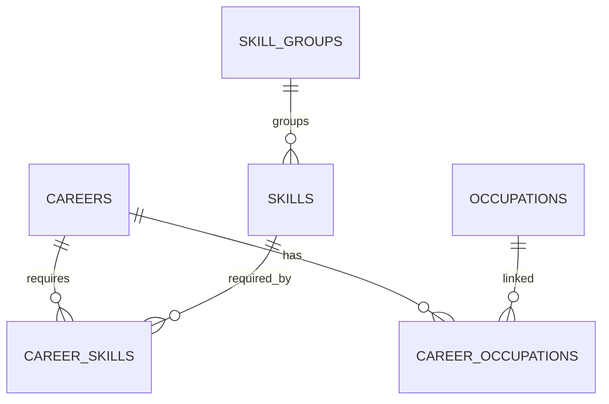
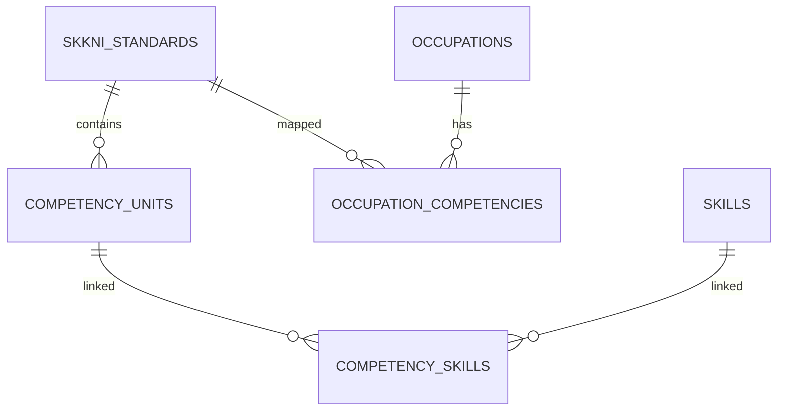
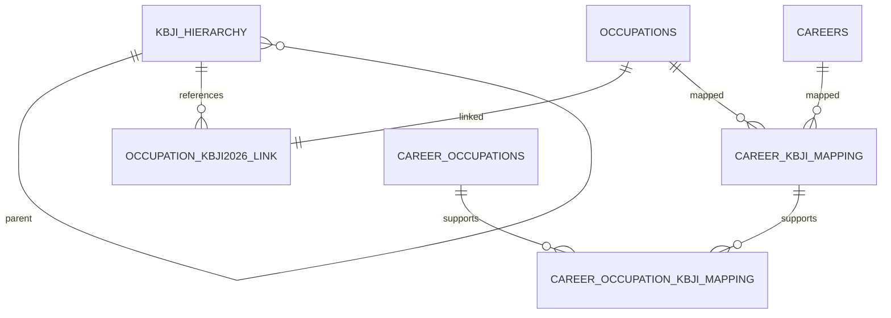
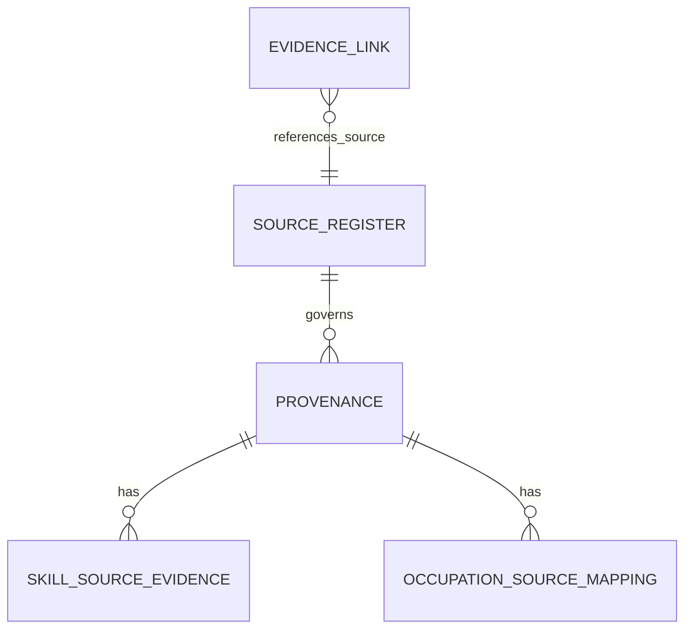

# T4-R2 — Target Database Schema Design for Extended OKB

**Status:** Design-only (no implementation).  
**Date:** 2026-11-02  
**Primary workbook:** `data/occupational_knowledge_base_verified_v1_0_extended.xlsx`  
**Workbook SHA-256:** `792fdbffce25ad7266514e58a8f890877012d13ba672f13c386bacb4df39694d`  
**Reference (legacy):** `data/occupational_knowledge_base_verified_v1_0.xlsx` (SHA-256 `CE858A6AEBE31D8237BF11217CCE538D3CD657F4572D838866D2707B5536A630`)  
**Authoritative context:** `docs/design-freeze.md`, `docs/master_checklist_pra_ablation.md`, `docs/evaluation/DECISIONS.md`, `docs/evaluation/EXPERIMENT_SPEC.md`, `docs/design/T3_DATA_MODEL_AND_PIPELINE_CONTRACT.md`, `docs/audits/T4_OKB_READINESS_AUDIT.md`, `docs/audits/T4_R1_EXTENDED_WORKBOOK_STRUCTURAL_AUDIT.md`, `docs/audits/T4_R1A_AUDIT_CLARIFICATION.md`

> **Safety:** No source code, workbook, or database was modified in producing this document. Existing PostgreSQL databases `career_intelligence` and `career_intelligence_e2e_test` are not disposable; target/destructive operations require separate approval.

### Revision note (T4-R2A)

This revision corrects five design decisions in the original T4-R2 draft:

1. **Database separation resolved to one database, two schemas (`app`, `okb`).** Repository inspection shows the application uses a single SQLAlchemy `engine` for both domains and performs no SQL joins between user tables and OKB tables. A standalone OKB database would require a second engine plus service-layer rewiring; two schemas in one dedicated database keeps the single-engine contract and permits `app.user_skills.skill_id → okb.skills.skill_id` as a real FK. A *new* database is chosen because the existing `career_intelligence` already holds legacy OKB tables in `public`, which would collide with a new `okb` schema under a shared `search_path`.
2. **TECHNOLOGY and TASK are excluded from operational import** (not treated as eligible OKB data). They may only be imported into isolated historical staging tables that no operational repository or agent reads.
3. **Unresolved source references are preserved and quarantined**, never given artificial `SOURCE_REGISTER` rows. Raw identifier is retained; resolved FK is nullable; status is `RESOLVED`/`UNRESOLVED`/`QUARANTINED`; unresolved links are excluded from evidence retrieval and scoring.
4. **EVIDENCE_LINK validation is strengthened** with an explicit target-table allowlist, per-target PK existence checks, import-time validation, repository-time filtering, and required negative tests.
5. **Compatibility claims were re-assessed** against the chosen architecture; they are no longer justified by table-name stability alone.

No frozen research decision was changed (10 careers, `compute_career_fit()`, four skill-gap categories, PASS-only activity evidence, verification/`max_revisions`, technology/competency separation, competency normalization).

### Revision note (T4-R2B)

Four limited corrections, without reopening prior design decisions:

1. **`CAREER_OCCUPATION` `record_id` verified, not assumed.** Read-only inspection of all 65 `EVIDENCE_LINK` rows with `record_table='CAREER_OCCUPATION'` found 12 distinct values, all of the form `career_id|occupation_id` (e.g. `C01|O01`), all matching `^[A-Z0-9]+\|[A-Z0-9]+$`, and all 12 pairs exist in `CAREER_OCCUPATION`. The resolution rule is now stated from that evidence; malformed IDs become `INVALID_TABLE` and absent pairs `ORPHAN_TARGET` (no guessing).
2. **Target and source statuses separated.** `target_resolution_status` now contains only `RESOLVED`, `ORPHAN_TARGET`, `INVALID_TABLE`, `AMBIGUOUS`; `UNRESOLVED_SOURCE` was removed. `source_resolution_status` remains `RESOLVED`, `UNRESOLVED`, `QUARANTINED`. Repository filtering applies both predicates independently.
3. **User-data migration deferred.** Copying the nine user tables is now an optional, separately approved step, not a prerequisite for importing the OKB. The OKB import and validation complete without user data, and existing databases are never modified or deleted.
4. **Eligibility remains a strict gate.** `operational_evidence_present` is never used to grant eligibility. *(Superseded by T4-R2C: the per-record `VALIDATED` condition has been replaced by a dataset-level manual review approval; see the T4-R2C note below.)*

### Revision note (T4-R2C)

This revision records the researcher's clarification that the **entire extended workbook has been manually reviewed** (all records, source references, and evidence links). Four changes follow; no frozen decision is reopened and no workbook/source/database change is implied.

1. **Per-record `validation_status = VALIDATED` removed as an eligibility condition.** The researcher reviewed every record personally, so eligibility no longer depends on a per-record `validation_status` column. That column is **not** reintroduced or extended in the target schema, and any legacy workbook column of that name is descriptive only and ignored for eligibility.
2. **Manual validation is documented as a dataset-level approval**, bound to the exact workbook SHA-256 fingerprint (`792fdbffce25ad7266514e58a8f890877012d13ba672f13c386bacb4df39694d`), the reviewer identity/role (the thesis researcher, who performed the full manual review), the actual review date **if known** (not recorded in this task; left `NULL`/to be supplied — no date is invented), and the review scope (all workbook records, all source references, all evidence links). The approval is stored as an append-only audit record (`workbook_review_approval` / `import_manifest`), not as per-row state.
3. **Three independent layers are now explicitly separated:** (a) dataset-level manual review approval, (b) individual target/source reference resolution, and (c) source permission to contribute to scoring (`can_contribute_to_scores`). Manual review does **not** auto-resolve malformed or missing references and does **not** override source contribution restrictions.
4. **Eligibility conditions remain independent and strict:** `target_resolution_status = RESOLVED` **and** `source_resolution_status = RESOLVED` **and** the resolved source has `can_contribute_to_scores = TRUE`, **and** the dataset has an approval for the exact workbook hash. `operational_evidence_present` is still never used. Unresolved/quarantined references remain excluded from scoring even though they were manually reviewed.

No source ID, workbook record, eligibility flag, or source contribution setting is changed by this revision. No import, database write, or runtime change is performed.

## 1. Executive Summary

This document defines the **target PostgreSQL schema** for importing the extended OKB workbook (`v1_0_extended.xlsx`) as the primary OKB source. Key design principles:

- **Preserve frozen decisions.** Exactly 10 canonical IT careers. `compute_career_fit()` remains the sole source of truth for career-fit calculations. Preserve exactly four skill-gap categories: `matched_evidenced`, `matched_claimed_only`, `missing`, `unmatched_user_claims`. No skill-gap priority/proficiency-gap additions. 
- **Evidence discipline.** Only PASS Activity–Skill candidates create activity-derived `CompetencyEvidence`. Self-report without accepted evidence stays `matched_claimed_only`. Technology mentions never constitute competency evidence; competency and technology normalization remain separate.
- **Grounding-first.** Do not invent sources/KBJI/SKKNI units/elements/KUK or import ESCO/O*NET. Unresolved references are not valid evidence.
- **Current state constraints.** No per-record `validation_status = VALIDATED` gate is used; eligibility is determined by dataset-level manual review approval combined with reference resolution and source permissions. `eligible_for_career_fit`/`eligible_for_skill_gap` are all FALSE in the workbook as distributed; there is no `eligible_for_scoring` column. `operational_evidence_present` is **not** scoring eligibility. 
- **Known data issues to handle:** EVIDENCE_LINK is polymorphic with 35 duplicate `(record_table,record_id,source_id)` triples (not identical rows; triple not unique). `supporting_kbji_mapping_ids` is semicolon-delimited M:N and must be normalized via junction. Source resolution gaps exist (`SRC`, `SRC-`, `SRC-KBJI-2014-2026` missing from `SOURCE_REGISTER`; orphan `OSM002`). KBJI code `2120` appears in links but missing from curated `KBJI_HIERARCHY`/`KBJI_OCCUPATION` subset (unresolved). SKKNI has partial coverage (8/14 standards have 0 units; SK10-SK14 screening-only). 24 skills lack structured `SKILL_SOURCE_EVIDENCE` rows but have career-level evidence + EVIDENCE_LINK coverage.

**Recommendation:** Migrate to a normalized relational schema held in **one dedicated database with two schemas** — `okb` for occupational data and `app` for user data — using a **single SQLAlchemy engine**. This keeps the current single-engine contract, allows a real FK from `app.user_skills.skill_id` to `okb.skills.skill_id`, and avoids cross-database limitations. Keep append-only history where relevant (candidate versions/verification findings), enforce provenance, and quarantine unresolved references. Scoring eligibility is gated by (a) the dataset-level manual review approval bound to the exact workbook SHA-256, (b) resolved target and source references, and (c) a source with `can_contribute_to_scores = TRUE` — never by `operational_evidence_present`. `TECHNOLOGY` and `TASK` are **excluded from operational import** (see §3).

## 2. Target Architecture

### 2.1 Design Goals
- **Deterministic-first:** KB access remains read-only via repositories/services; `compute_career_fit()` unchanged.
- **Traceability:** Every evidence link must resolve to known sources/records or be marked `UNRESOLVED` with audit trail.
- **Separation of concerns:** Keep user-domain tables (existing `users`, `user_skills`, etc.) separate from OKB domain. OKB is the grounding source.
- **Polymorphic safety:** Handle `EVIDENCE_LINK` without relying on a single cross-table FK (Postgres limitation).
- **Normalization:** Replace semicolon-delimited M:N with junction tables.
- **Safety:** No destructive changes to existing DBs; migration must be idempotent and reversible.

### 2.2 Database Architecture Decision (resolved)

**Evidence from the existing application:**

| Question | Finding | Evidence |
|---|---|---|
| Do user-domain and OKB repositories share one engine/session? | **Yes.** Both import the same lazy `engine` from `app.core.db`, which is built from a single `CAREER_DB_URL` / `CAREER_DB_*` configuration. | `backend/app/core/db.py` (`_engine`, `get_engine`), `backend/app/services/retrieval_service.py:12`, `backend/app/services/user_service.py:7` |
| Do service operations require SQL joins between user and OKB data? | **No.** User repositories query only `users`, `user_profiles`, `user_education`, `user_experience`, `user_projects`, `user_certifications`, `user_skills`, `user_skill_evidence`, `user_preferences`. OKB repositories query only OKB tables. Cross-domain matching happens in Python on `skill_id` in `skill_gap_service`. | `backend/app/repositories/user_repository.py`; `career_repository.py`; `occupation_repository.py`; `skill_gap_service.py:167-176` |
| Would two databases require separate engines/sessions and service-layer changes? | **Yes.** Each domain would need its own engine/URL; `retrieval_service` and `user_service` would both need rewiring, and cross-database FKs/joins are unavailable. | `db.py` single-engine design |
| Would two schemas (`app`, `okb`) in one dedicated database be simpler? | **Yes.** One engine, one connection, schema-qualified resolution; enables `app.user_skills.skill_id → okb.skills.skill_id` FK; no service-layer dual-engine work. | Same evidence |
| Would a new database containing both domains require safe user-data migration? | **Yes**, if the existing user tables are to be carried over. This is a one-time, approval-gated copy — not a destructive operation on existing DBs. | Existing DBs must be preserved |

**Alternatives compared:**

- **A. Standalone OKB database.** Rejected. It forces a second engine, changes both services, blocks the `user_skills.skill_id → skills.skill_id` FK, and makes any future cross-domain query impossible in SQL. It would invalidate the earlier "reuse unchanged" claim.
- **B. Two schemas (`app`, `okb`) in one dedicated target database.** **Recommended.** Single engine; `search_path = app,okb` lets existing unqualified SQL resolve correctly (`users`/`user_skills` from `app`, `skills`/`careers` from `okb`). Real FK across domains is possible. Requires a new database and an approval-gated user-data copy.
- **C. New database containing both domains.** This is the same as B for schema layout; B is the concrete form. A new DB is preferred over adding `okb` to `career_intelligence` because that database already contains legacy OKB tables in `public`, which would collide under a shared `search_path`.
- **D. Add `okb` schema to existing `career_intelligence`.** Rejected as the primary target: legacy `public.skills`/`careers` etc. already exist, so unqualified names would be ambiguous and search-path ordering could silently hit legacy tables. It also mixes target and legacy data in one database.

### 2.3 Schema Organization (recommended)

**Target:** one dedicated database (proposed name `career_intelligence_okb`) with two schemas:

- **`okb` schema** — all occupational data:
  - Core: `careers`, `occupations`, `career_occupations`, `skill_groups`, `skills`, `career_skills`
  - Competency/SKKNI: `skkni_standards`, `competency_units`, `occupation_competencies`, `competency_skills`
  - KBJI: `kbji_hierarchy`, `kbji_occupation`, `occupation_kbji2026_link`, `career_kbji_mapping`, `career_occupation_kbji_mapping`
  - Provenance/governance: `provenance`, `source_register`, `skill_source_evidence`, `occupation_source_mapping`, `evidence_link`
  - Audit: `etl_transform_log`, `import_manifest`, `evidence_link_resolution_audit`
- **`app` schema** — user-domain tables copied from the existing schema (`users`, `user_profiles`, `user_education`, `user_experience`, `user_projects`, `user_certifications`, `user_skills`, `user_skill_evidence`, `user_preferences`), unchanged in shape.
- **Isolated staging schema (optional, only if staging is approved):** `staging_historical` for `TECHNOLOGY`/`TASK`; never read by operational repositories or agents.

Set the connection `search_path` to `app,okb` (or `app,okb,staging_historical` if staging is approved). `app` first ensures user tables resolve to the user domain; unqualified OKB names resolve to `okb` because `app` contains no OKB tables. This preserves the existing unqualified SQL in the repositories without rewriting every query.

> **No database is provisioned or modified by this document.** Creating the target database, creating schemas, and copying user data all require separate explicit approval.

## 3. Workbook-to-Table Mapping

All 25 sheets from the extended workbook mapped to target tables. Classification: CORE OPERATIONAL / REFERENCE / PROVENANCE / STAGING/AUDIT / EXCLUDED/HISTORICAL (explain role).

| Workbook Sheet | Target Table | Type | Role | Notes |
|---|---|---|---|---|
| `CAREER` | `careers` | CORE OPERATIONAL | Canonical careers (must be exactly 10). | `career_id` PK. Preserve frozen set. |
| `OCCUPATION` | `occupations` | CORE OPERATIONAL | Occupations linked to careers. | `occupation_id` PK. |
| `CAREER_OCCUPATION` | `career_occupations` | CORE OPERATIONAL | M:N between careers/occupations. | Has `legacy_career_occupation_id`; composite `(career_id,occupation_id)` unique. |
| `SKILL_GROUP` | `skill_groups` | REFERENCE | Skill categorization. | `skill_group_id` PK. |
| `SKILL` | `skills` | CORE OPERATIONAL | Canonical skills (87 in extended). | `skill_id` PK. 24 skills have no `SKILL_SOURCE_EVIDENCE` rows but have evidence elsewhere. |
| `CAREER_SKILL` | `career_skills` | CORE OPERATIONAL | Career-skill requirements with evidence metadata. | `relationship_id` PK; `(career_id,skill_id)` unique. `evidence_source` free-text critical for 24 skills. |
| `SKKNI_STANDARD` | `skkni_standards` | REFERENCE/PROVENANCE | SKKNI standards (14). Merge `STANDARD_COVERAGE`. | Some standards screening-only (SK10-SK14) with no units/coverage row. |
| `STANDARD_COVERAGE` | (merged into `skkni_standards` or `skkni_standard_coverage`) | REFERENCE | Coverage metadata. | Better merged into `skkni_standards` with flags `unit_inventory_status`, `record_origin`; or separate table. Recommend merge for simplicity but keep `record_origin`. |
| `COMPETENCY_UNIT` | `competency_units` | REFERENCE | SKKNI units/elements context. | Normalize unit_id padding (importer already does). Do **not** fabricate missing units. |
| `OCCUPATION_COMPETENCY` | `occupation_competencies` | CORE OPERATIONAL | Occupation-SKKNI links. | `relationship_id` PK. |
| `COMPETENCY_SKILL` | `competency_skills` | CORE OPERATIONAL | Unit-skill links. | `relationship_id` PK. |
| `TECHNOLOGY` | **Excluded from operational** (optional `staging_historical.technologies`) | REFERENCE (HISTORICAL/STAGING) | Historical/market signals only. | Excluded from operational import. Never retrieved by operational repositories or agents for scoring/evidence. |
| `TASK` | **Excluded from operational** (optional `staging_historical.tasks`) | REFERENCE (HISTORICAL/STAGING) | Historical/task context only. | Excluded from operational import. Never retrieved by operational repositories or agents for scoring/evidence. |
| `PROVENANCE` | `provenance` | PROVENANCE | Source documents/records. | `provenance_id` PK. |
| `SOURCE_REGISTER` | `source_register` | PROVENANCE/GOVERNANCE | Source governance (permissions, role, `can_contribute_to_scores`). | Critical for eligibility. Currently missing `SRC`, `SRC-`, `SRC-KBJI-2014-2026`. |
| `OCCUPATION_SOURCE_MAPPING` | `occupation_source_mapping` | PROVENANCE | Occupation-source mappings. | Has provenance derivation issues; `OSM002` orphan referenced. |
| `SKILL_SOURCE_EVIDENCE` | `skill_source_evidence` | PROVENANCE | Structured skill-level evidence. | 63/87 skills have rows; combine with `career_skills.evidence_source` (see evidence_repository). |
| `EVIDENCE_LINK` | `evidence_link` | PROVENANCE | Polymorphic evidence links. | `link_id` PK (EV-#####). **Do not** use `(record_table,record_id,source_id)` as unique key. |
| `KBJI_HIERARCHY` | `kbji_hierarchy` | REFERENCE | KBJI hierarchy subset (curated). | Parent-child; `2120` missing (unresolved). |
| `KBJI_OCCUPATION` | `kbji_occupation` | REFERENCE | KBJI occupations. | 75 occupations. |
| `OCCUPATION_KBJI2026_LINK` | `occupation_kbji2026_link` | REFERENCE | Occupation-KBJI links. | References hierarchy level. |
| `CAREER_KBJI_MAPPING` | `career_kbji_mapping` | REFERENCE | Career-KBJI candidate mappings. | Workbook `validation_status` values are descriptive only; not an eligibility input (§7). |
| `KJN_SOURCE_CLAIMS` | `kjn_source_claims` | REFERENCE | Source claims. | Contextual. |
| `README` | — (not imported) | EXCLUDED/DOCUMENTATION | Human-readable workbook notes only. | Not an operational data sheet; retain as source documentation. |
| `STATUS_AUDIT` | `import_manifest` / `status_audit_snapshot` (optional) | AUDIT | Stale documentation counts. | Do not treat as authoritative; recompute counts during import. |

> **Note:** `supporting_kbji_mapping_ids` in `CAREER_OCCUPATION` is semicolon-delimited → moved to junction table `career_occupation_kbji_mapping` (see §4). The README references `CONFIG_ELIGIBILITY`, but that sheet is **not present** in the extended workbook; eligibility derivation must be defined independently (§7), not inferred from a missing sheet.

> **TECHNOLOGY / TASK scope decision:** The thesis excludes ESCO and O*NET, and both sheets are historical/ineligible (`operational_evidence_present=FALSE`; all eligibility flags FALSE; no `can_contribute_to_scores` source). **Decision: exclude both sheets from the operational `okb` schema.** If the researcher wants to retain them for reference, import only into `staging_historical`, with a schema permission model that grants no read access to operational services. The target `retrieval_service`/repositories must **not** expose `staging_historical`. `occupation_repository.fetch_tasks_for_occupation` and `fetch_technologies_for_occupation` are therefore **retired from the operational path** (see §9); any retained context must come from approved, non-scoring sources. Technology mentions still never constitute competency evidence.

## 4. Entity Relationship Design

### 4.1 Core Career/Occupation/Skill

- `careers(career_id PK, canonical_name, domain)` - exactly 10
- `occupations(occupation_id PK, canonical_name, classification)`
- `career_occupations(id/legacy_career_occupation_id PK or (career_id,occupation_id) UK, career_id FK->careers, occupation_id FK->occupations, mapping_method, confidence)`
- `skill_groups(skill_group_id PK, name)`
- `skills(skill_id PK, canonical_name, skill_group_id FK->skill_groups, status)`
- `career_skills(relationship_id PK, career_id FK->careers, skill_id FK->skills, evidence_class, confidence, mapping_method, evidence_source, ...) UK(career_id,skill_id)`

### 4.2 Competency/SKKNI

- `skkni_standards(standard_id PK, number, year, title, status, record_origin, unit_inventory_status, unit_count_in_dataset, evidence_basis, coverage_action_note)`
- `competency_units(unit_id PK, standard_id FK->skkni_standards, code, title)` (padding-normalized)
- `occupation_competencies(relationship_id PK, occupation_id FK->occupations, standard_id FK->skkni_standards, mapping_confidence)`
- `competency_skills(relationship_id PK, unit_id FK->competency_units, skill_id FK->skills, mapping_method)`

### 4.3 KBJI

- `kbji_hierarchy(node_id PK, kbji_code, level, parent_node_id FK->kbji_hierarchy, title, definition, verification_status)` - curated subset; `2120` **not present** (unresolved)
- `kbji_occupation(occupation_id PK, occupation_code, title, parent_subgolongan_codes, verification_status)`
- `occupation_kbji2026_link(link_id PK, occupation_id FK->occupations UK, kbji2026_code, kbji2026_title, match_type, match_basis)`
- `career_kbji_mapping(mapping_id PK, career_id FK->careers, occupation_id FK->occupations, evidence_summary, coverage_status, confidence_level, supporting_kbji_mapping_ids_legacy)` (keep legacy column read-only during migration or drop after junction). The workbook's `validation_status`/`expert_review_status` columns are **not** carried into the target eligibility model; manual review is dataset-level (§7).
- **NEW:** `career_occupation_kbji_mapping(id PK or (career_occupation_id/mapping_key, mapping_id) PK, career_id FK, occupation_id FK, mapping_id FK->career_kbji_mapping)` replacing semicolon-delimited `supporting_kbji_mapping_ids`. Ensure FKs and unique (career_id,occupation_id,mapping_id).

### 4.4 Provenance, Evidence, Sources

- `provenance(provenance_id PK, source_name, document_id, document_title, version_or_year, url, source_type, record_status)`
- `source_register(source_id PK, source_name, can_contribute_to_scores, selection_status, source_role, permission_status, verification_metadata, license_status, verification_content, ...)` 
- `skill_source_evidence(evidence_id PK, skill_id FK->skills, source_name, source_reference, evidence_type, confidence, mapping_basis, note, provenance_id FK->provenance)`
- `occupation_source_mapping(mapping_id PK, occupation_id FK->occupations, source_name, source_code, confidence, mapping_basis, provenance_id FK->provenance)`
- `evidence_link(link_id PK, record_table, record_id, source_id FK->source_register(source_id) or text with resolution, standard_id FK->skkni_standards NULL, evidence_component, resolution_status, resolution_notes)` - **polymorphic target** (see §6)

## 5. Primary and Foreign Key Definitions

### 5.1 PK Strategy
- Prefer stable assigned/surrogate IDs where they exist (`career_id`, `skill_id`, `occupation_id`, `relationship_id`, `link_id`, `evidence_id`, `mapping_id`, `provenance_id`).
- Do **not** use natural descriptive fields as PKs.
- For `CAREER_OCCUPATION`, composite `(career_id,occupation_id)` is unique; keep `legacy_career_occupation_id` as alternate key if needed.
- `EVIDENCE_LINK.link_id` is the identifier (EV-#####). **Never** use `(record_table, record_id, source_id)` as unique key (35 duplicates confirmed).

### 5.2 FK Strategy (relational where possible)
Where target is unambiguous single table: add FKs (`career_skills.career_id->careers`, `career_skills.skill_id->skills`, `competency_skills.unit_id->competency_units`, `competency_skills.skill_id->skills`, etc.). For polymorphic `EVIDENCE_LINK(record_table, record_id)` **no single FK column is possible** - use application-level validation + referential audit table (see §6).

### 5.3 Unique Constraints
- `careers(career_id)`, `occupations(occupation_id)`, `skills(skill_id)`, `skill_groups(skill_group_id)`
- `career_skills(career_id, skill_id)`
- `career_occupations(career_id, occupation_id)` (UK)
- `skkni_standards(standard_id)`, `competency_units(unit_id)`, `competency_skills(relationship_id)`, `occupation_competencies(relationship_id)`
- `provenance(provenance_id)`, `source_register(source_id)`, `skill_source_evidence(evidence_id)`, `evidence_link(link_id)`
- `occupation_kbji2026_link(occupation_id)`, `career_kbji_mapping(mapping_id)`
- `career_occupation_kbji_mapping(career_id, occupation_id, mapping_id)` (UK)

### 5.4 Nullable Fields & Indexes (key ones)
- `career_skills.evidence_source` may be NULL? Extended shows non-empty in cases; keep nullable but documented. `confidence` present.
- `skill_source_evidence.provenance_id` nullable (derivation can fail).
- `occupation_source_mapping.provenance_id` nullable (IndoTask cases).
- `evidence_link.standard_id` nullable (684/970 null). `source_id` may be unresolved initially.
- **Indexes:** `career_skills(career_id)`, `career_skills(skill_id)`, `competency_skills(unit_id)`, `competency_skills(skill_id)`, `evidence_link(record_table,record_id)`, `evidence_link(source_id)`, `evidence_link(link_id)`, `skill_source_evidence(skill_id)`, `career_occupation_kbji_mapping(mapping_id)`, `career_kbji_mapping(career_id,occupation_id)`.

## 6. Evidence and Provenance Design

### 6.1 EVIDENCE_LINK Polymorphic Design
**Problem:** `EVIDENCE_LINK` uses `(record_table, record_id)` to point to different tables; Postgres cannot enforce cross-table FK directly. `link_id` is the identifier. `(record_table, record_id, source_id)` is **not unique** (35 triples duplicated - different `standard_id`/`evidence_component`).

**Options considered (per instruction C):**
1. **Polymorphic reference + application-level validation** - keep columns as-is, validate on read/write, log violations.
2. **Dedicated junction/link tables per target** - e.g. `evidence_link_career_skill`, `evidence_link_skill`, etc., each with proper FK to target and to `evidence_link`/source. Stronger integrity but more tables.
3. **Unified target registry** - create `evidence_target` table mapping (record_table, record_id) to synthetic target_id; enforce FK. Adds indirection/complexity.

**Recommendation: Option 1 (hardened polymorphic reference), not a new registry.**
`link_id` remains the PK. No uniqueness on `(record_table, record_id, source_id)`.

**Explicit target-table allowlist** (anything else is invalid):

| `record_table` | Target table | Target key type / existence check |
|---|---|---|
| `CAREER_SKILL` | `okb.career_skills` | `record_id = relationship_id` |
| `SKILL` | `okb.skills` | `record_id = skill_id` |
| `COMPETENCY_SKILL` | `okb.competency_skills` | `record_id = relationship_id` |
| `CAREER_OCCUPATION` | `okb.career_occupations` | **Verified rule:** all 65 workbook rows use `record_id = '<career_id>|<occupation_id>'` (12 distinct values; all 12 pairs exist in `CAREER_OCCUPATION`; every value matches `^[A-Z0-9]+\|[A-Z0-9]+$`). Split on the single `|` and check the pair exists. Malformed → `INVALID_TABLE`; well-formed but absent pair → `ORPHAN_TARGET`. Do not assume any other format. |
| `CAREER_KBJI_MAPPING` | `okb.career_kbji_mapping` | `record_id = mapping_id` |
| `OCCUPATION_SOURCE_MAPPING` | `okb.occupation_source_mapping` | `record_id = mapping_id` |
| `OCCUPATION_COMPETENCY` | `okb.occupation_competencies` | `record_id = relationship_id` |
| `TASK` | **not allowed operationally** (staging only) | — |
| `TECHNOLOGY` | **not allowed operationally** (staging only) | — |

**Row fields:**
- `link_id` text PK; `record_table` text NOT NULL; `record_id` text NOT NULL; `source_reference_raw` text NOT NULL; `resolved_source_id` text NULL FK→`source_register`; `standard_id` text NULL FK→`skkni_standards`; `evidence_component` text NULL.
- `target_resolution_status` enum (target only): `RESOLVED` \| `ORPHAN_TARGET` \| `INVALID_TABLE` \| `AMBIGUOUS`.
- `source_resolution_status` enum (source only): `RESOLVED` \| `UNRESOLVED` \| `QUARANTINED` (defined in §6.2).
- `target_resolution_note` text NULL; `resolution_checked_at` timestamptz NULL.
- **No** DB-level polymorphic FK. Enforce via import-time validation plus repository-time filtering (below).

**Import-time validation (fail-closed per row, never abort silently):**
1. Reject unknown `record_table` → `target_resolution_status = INVALID_TABLE`.
2. For each allowed table, run the table-specific existence check. Missing target → `ORPHAN_TARGET` (e.g. `OSM002`).
3. `CAREER_OCCUPATION` `record_id` is split on the single `|` (verified format, §6.1 allowlist); malformed → `INVALID_TABLE`; pair absent → `ORPHAN_TARGET`.
4. Ambiguous resolution (more than one plausible target row for a non-unique natural key) → `AMBIGUOUS`, never guessed.
5. Source reference not genuinely resolvable → `source_resolution_status = UNRESOLVED` or `QUARANTINED`; this is **independent** of `target_resolution_status` and does not get a target enum value.
6. Write every row with `target_resolution_status != RESOLVED` or `source_resolution_status != RESOLVED` to `evidence_link_resolution_audit` and to the import manifest counts. Import continues; non-resolved rows are retained for audit.

**Repository-time filtering (mandatory, separate predicates):**
- `evidence_repository`/`retrieval_service` may return only rows where **both** `target_resolution_status = 'RESOLVED'` **and** `source_resolution_status = 'RESOLVED'` **and** the resolved source has `can_contribute_to_scores = TRUE`.
- The two statuses are independent: a row can have a valid target but an unresolved source, or vice versa; either condition is sufficient to exclude it from evidence retrieval.
- Filtering belongs in the repository query (WHERE clause), not only in agents, so no caller can accidentally read quarantined evidence.
- Agents (including Verification Agent) must never be handed unresolved links as valid evidence.

**Required tests (implementation stage):**
- A quarantined `SRC`/`SRC-` link is excluded from evidence retrieval.
- An orphan target (`OSM002` style) is excluded and counted in the audit.
- A `TECHNOLOGY`/`TASK` link is rejected as invalid even if present in staging.
- A valid `SRC-KBJI`/`SRC-SKKNI` link resolves and is retrievable.
- No query returns a link with `target_resolution_status != 'RESOLVED'`.
- Duplicate `(record_table, record_id, source_id)` rows remain distinct and retrievable (proves no uniqueness was introduced).

**Also handle duplicates:** Treat duplicate triple rows as **different evidence entries** (different `standard_id`/`evidence_component`) — not errors. Uniqueness is on `link_id` only.

### 6.2 Source Resolution (no artificial register entries)
**Principle:** Do **not** create `SOURCE_REGISTER` rows for malformed/unresolved references (`SRC`, `SRC-`) or for an unregistered reference (`SRC-KBJI-2014-2026`). Adding fake sources would silently legitimise them.

Design on every evidence-bearing row (and on `evidence_link`):

| Field | Type | Rule |
|---|---|---|
| `source_reference_raw` | text, NOT NULL | Original workbook value (`SRC`, `SRC-`, `SRC-KBJI-2014-2026`, `OSM002`, `EV-00881`, …). Never rewritten. |
| `source_id` / `resolved_source_id` | text, NULL | FK to `source_register.source_id`. `NULL` until genuinely resolved. |
| `source_resolution_status` | enum | `RESOLVED` \| `UNRESOLVED` \| `QUARANTINED`. |
| `source_resolution_note` | text, NULL | Why unresolved/quarantined; points to audit evidence. |
| `source_resolved_at` | timestamptz, NULL | When resolution last checked. |

Rules:
- `SRC` (274 links), `SRC-` (138 links): `source_reference_raw` preserved, `resolved_source_id = NULL`, `source_resolution_status = QUARANTINED`. They are **not** added to `source_register`.
- `SRC-KBJI-2014-2026` (8 OSM rows): preserved raw, `resolved_source_id = NULL`, `QUARANTINED`. Do not alias it to `SRC-KBJI`.
- `OSM002` / `EV-00881`: the target does not exist. Preserve the reference as an audit row (`QUARANTINED`), do not fabricate the mapping. Restoring or removing it requires a verified decision.
- Any record whose only evidence links are unresolved/quarantined **must not** be used for evidence retrieval or scoring. `scoring_eligible` remains false and `evidence_link` is filtered out at read time.
- Legitimate sources (`SRC-KBJI`, `SRC-SKKNI`) resolve normally; non-qualifying yet registered sources resolve with `can_contribute_to_scores=FALSE` and remain non-scoring.

### 6.3 Provenance
- `provenance` table stores documents; links from `skill_source_evidence` and `occupation_source_mapping`. Some derivations fail (IndoTask) leaving NULL - allowed but tracked.
- `etl_transform_log` already exists pattern (importer creates it) - keep for append-only transform history.

## 7. Eligibility and Validation Design

### 7.1 Eligibility Rules (must follow)
Three independent layers are evaluated separately and must not be conflated:

1. **Dataset-level manual review approval.** The researcher has personally reviewed every record in the extended workbook, including all source references and evidence links. This approval is bound to the **exact workbook SHA-256** (`792fdbffce25ad7266514e58a8f890877012d13ba672f13c386bacb4df39694d`), the reviewer identity/role, the actual review date **if known** (not recorded here — `NULL`, never invented), and the review scope (all workbook records, all source references, all evidence links). Any workbook with a different hash is **not** covered by this approval.
2. **Individual reference resolution.** Each evidence link's target (`target_resolution_status = RESOLVED`) and source (`source_resolution_status = RESOLVED`) must resolve independently. Manual review does **not** auto-resolve malformed or missing references.
3. **Source permission.** The resolved source must have `can_contribute_to_scores = TRUE`. Manual review does **not** override a source's contribution restriction.

**Eligibility rule:** a record is `scoring_eligible` only if **all** of the following hold:
- the dataset approval exists for the exact workbook SHA-256;
- `target_resolution_status = RESOLVED`;
- `source_resolution_status = RESOLVED`;
- the resolved source has `can_contribute_to_scores = TRUE`.

**No per-record `validation_status = VALIDATED` condition is used.** The workbook has no such per-record gate; the approval is dataset-level. Manual review does not by itself make a record eligible.

- **`operational_evidence_present` != eligibility:** 85 rows have qualifying links but `operational_evidence_present = FALSE` (SKILL/CAREER_SKILL/CAREER_KBJI_MAPPING) — flag is not consistently computed. Operational evidence availability is a separate signal and is **never** used to grant scoring eligibility.
- **Unresolved/quarantined references remain excluded**, even though they were manually reviewed: `SRC`, `SRC-`, `SRC-KBJI-2014-2026` and orphan `OSM002` stay out of evidence retrieval and scoring until genuinely resolved.
- **Current result:** eligibility is therefore not "zero because nothing is validated"; it follows from the three conditions above. Records whose links resolve to a qualifying source can be eligible under the approved workbook, while quarantined/orphan links remain ineligible. `eligible_for_career_fit`/`eligible_for_skill_gap` workbook flags remain untouched and are not the authority. The OKB has **not** undergone independent third-party expert validation; the approval is the researcher's own manual review.

### 7.2 Schema Design for Eligibility
Add explicit fields:
- `scoring_eligible` (boolean, computed) — **derived field**, computed from the four conditions in §7.1 (dataset approval + target resolved + source resolved + `can_contribute_to_scores = TRUE`). Never copied from workbook flags.
- `eligibility_reason` (text) for audit (which condition failed).
- `eligibility_checked_at` (timestamp).
- `dataset_approval_id` (nullable FK → `workbook_review_approval.approval_id`) used to evaluate condition 1.

**Do not add** a per-record `validation_status` or `expert_review_status` column to the target schema. The existing workbook `CAREER_KBJI_MAPPING.validation_status` column, if imported for data fidelity, is descriptive only and **must not** be used in the eligibility computation.

**Dataset approval table (audit):** `workbook_review_approval(approval_id PK, workbook_sha256 UNIQUE NOT NULL, reviewer_identity text NOT NULL, reviewer_role text NOT NULL, reviewed_at timestamptz NULL, review_scope text NOT NULL, approval_status text NOT NULL, recorded_at timestamptz NOT NULL)`. One append-only row per approved workbook artifact. `reviewed_at` stays `NULL` until the researcher supplies the real date; `reviewer_identity` records the thesis researcher who performed the review; the scope records "all records, all source references, all evidence links". The same approval facts are mirrored into `import_manifest`.

**Rule:** In the target schema, `scoring_eligible` must be computed by import/validation logic. For the primary experiment, only `scoring_eligible = TRUE` records count regardless of the workbook's `eligible_for_*` flags.

### 7.3 Reference Resolution and Validation
- Preserve existing workbook columns for fidelity where they already exist (e.g. `CAREER_KBJI_MAPPING` has NEEDS_REVIEW/UNRESOLVED), but they are **not** eligibility inputs.
- Import validation must check: every evidence link resolves to a registered source or is marked unresolved/quarantined; no silent source mapping; every polymorphic target exists in its allowed table.
- **Unresolved/quarantined references never contribute to eligibility**, even though the researcher reviewed them: the link is filtered out at read time and the record is `scoring_eligible = FALSE`.
- **TECHNOLOGY/TASK are never eligibility inputs.** They are absent from the operational `okb` schema (or isolated in staging) and cannot make any career/skill eligible.
- Keep append-only verification findings and the dataset approval record (align with T3 requirement).

## 8. KBJI/SKKNI Handling

### 8.1 KBJI
- **Code `2120`:** Appears as `OCCUPATION.classification='KBJI 2120'`, in `OCCUPATION_KBJI2026_LINK` (kbji2026_code='2120'), in `OSM023` (source_code='2120'), and referenced by EVIDENCE_LINK. **Not present in `KBJI_HIERARCHY` or `KBJI_OCCUPATION`** (curated subset of 30 nodes). `KBJI_HIERARCHY` has node `21` with text mentioning `212` subgolongan. 
- **Action:** Mark as **UNRESOLVED**. Do **not** fabricate hierarchy nodes. If verification against actual KBJI 2026 confirms it exists, add to `kbji_hierarchy` with proper parent/level; otherwise correct links/mappings or quarantine. Preserve references for audit.
- **Hierarchy:** Treat as curated subset; parent-child relations only where present.

### 8.2 SKKNI
- **Standards:** 14 total, all `Berlaku`. 
- **Coverage:** SK01,SK02,SK04,SK05,SK07 have units (COMPLETE). SK03 profile-complete (25 units, not full standard). SK06,SK08,SK09 have 0 units, marked PARTIAL in `STANDARD_COVERAGE` with note "do not infer unit titles". SK10-SK14 have **no STANDARD_COVERAGE row**, `record_origin='V0_1_SCREENING'` - screening-only, no units entered.
- **Action:** Preserve as-is. **Do not generate missing competency units/elements/KUK**. Mark screening-only standards distinctly (`record_origin='V0_1_SCREENING'`). Distinguish "not extracted" from "does not exist". Keep `unit_inventory_status` and notes.

### 8.3 Normalization Separation
- **Technology vs Competency:** No operational `technologies` table is imported from the extended workbook (see §3). Technology normalization behavior in the application is unchanged and remains separate from competency normalization. Technology mentions never create competency evidence or affect career-fit/skill-gap. Any future technology-to-competency mapping requires provenance and must not auto-confer evidence status.

## 9. Existing Application Compatibility

Inspect components per instruction F. Classify: Reuse without changes / Adapt to new schema / Replace / Retire. **Do not change application code in this stage.**

| Component | Current Usage | Assessment under chosen architecture | Classification |
|---|---|---|---|
| `app/core/db.py` | Single lazy `engine` from `CAREER_DB_URL`; used by both domains. | Retained; only the target URL/`search_path` changes (runtime config, not code). | **Reuse unchanged** |
| `app/repositories/career_repository.py` | Unqualified SQL over `careers`, `career_skills`, `career_occupations`, `skills`, `occupations`. | Resolves correctly with `search_path=app,okb`; no OKB/user SQL join. | **Reuse unchanged** (conditional on `search_path`) |
| `app/repositories/occupation_repository.py` — core competency/source queries | Unqualified SQL over OKB tables. | Resolves correctly under `okb`. | **Reuse unchanged** (conditional on `search_path`) |
| `app/repositories/occupation_repository.py` — `fetch_tasks_for_occupation`, `fetch_technologies_for_occupation` | Reads `tasks`/`technologies`. | These sheets are excluded from operational import; the functions must not read staging or legacy data. | **Retire from operational path** |
| `app/repositories/skill_repository.py` | Reads `skills`. | Resolves under `okb`. | **Reuse unchanged** |
| `app/repositories/evidence_repository.py` | Combines `skill_source_evidence` + `career_skills.evidence_source`; the 24-skill rule is mandatory. Must additionally filter unresolved/quarantined links. | Add `WHERE target_resolution_status='RESOLVED' AND source_resolution_status='RESOLVED'` and qualifying-source predicate. | **Adapt** |
| `app/repositories/user_repository.py` | User tables only; no KB reads. | Same engine/schema `app`; can gain a real FK `skill_id → okb.skills` (migration-time data check). | **Reuse unchanged** (code); schema gains FK |
| `app/services/career_fit_service.py` | Pure calculator; single source of truth. | No DB dependency; formula/weights untouched. | **Reuse unchanged** (MANDATORY) |
| `app/services/retrieval_service.py` | Builds `OccupationalContextOut`; currently calls tasks/technologies. | Remove/exclude `tasks` and `technologies` from the operational bundle; pass resolution-filtered evidence. | **Adapt** |
| `app/schemas/retrieval.py` | `TaskOut`, `TechnologyOut`, fields in `OccupationalContextOut`. | Tasks/technologies are not operational; remove from the operational contract or mark explicitly unavailable. | **Adapt** |
| `app/services/skill_gap_service.py` | Calls `compute_career_fit()` only; maps four categories. | Unchanged. | **Reuse unchanged** |
| `app/services/user_service.py` | Uses the shared engine for user tables. | Same engine; `search_path=app,okb` resolves user tables from `app`. | **Reuse unchanged** |
| `app/agents/skill_gap_agent.py` | Explains deterministic result. | Unchanged. | **Reuse unchanged** |
| `app/agents/learning_roadmap_agent.py` | Consumes skill-gap result only. | Unchanged. | **Reuse unchanged** |
| `app/agents/verification_agent.py` | Checks consistency/provenance; must not mutate silently; bounded revision. | Must read the new resolution/eligibility fields and treat unresolved links as non-evidence. | **Adapt** |
| `app/agents/profile_agent.py`, `skill_normalizer.py` | Normalize against `skills` catalog. | Catalog shape unchanged; competency normalization behavior preserved. | **Reuse unchanged** |
| `app/agents/career_recommendation_agent.py` | Uses `compute_career_fit()` via services. | Unchanged. | **Reuse unchanged** |
| `backend/scripts/import_kb.py`, `import_kb_fixed.py` | Legacy workbook → legacy schema; safety-guarded to e2e DB. | Wrong workbook/schema; no resolution/eligibility fields; would import TECHNOLOGY/TASK. | **Replace** (new extended importer, separate approval) |
| `backend/check_import_schema.py` | Legacy sheet→table check. | Legacy mapping only. | **Replace** |
| `app/diagnostics/runner.py` | Uses `get_engine()`. | Single engine retained. | **Reuse unchanged** |

**What is *not* a valid compatibility argument:** unchanged table names alone. Reuse above is justified only where (a) the component issues no cross-domain SQL, (b) the object resolves under `app,okb`, and (c) its behavior does not depend on excluded TECHNOLOGY/TASK or unresolved evidence.

**Minimum adaptation set (highest risk first):** `evidence_repository` → `retrieval_service` → `schemas/retrieval.py` → `verification_agent` → retire task/technology repository functions → new importer. `career_fit_service` and `skill_gap_service` must not change.

## 10. Migration and Rollback Strategy

### 10.1 Database Safety
- **Existing DBs:** `career_intelligence` and `career_intelligence_e2e_test` are **preserved unchanged**. They contain legacy OKB tables (`public`) and, in `career_intelligence`, synthetic test user data. Neither is disposable.
- **Target:** one dedicated database (proposed `career_intelligence_okb`) with schemas `okb` and `app`. A new database is chosen because the existing database already contains legacy OKB tables in `public`, which would collide with `okb` under a shared search path.
- **User data:** **not copied as part of OKB import.** Copying the nine user tables into `app` is a separate, optional decision that requires explicit approval. The OKB import into `okb` must be able to complete without any user data. Existing databases are read-only during any such option and are never modified or deleted.

### 10.2 Migration Strategy (proposed, approval-gated)
**Phase 0 — Preparation (this document only)**
1. Review/approve this design and the target database name.
2. Provision the target database and roles (no existing DB touched).

**Phase 1 — Schema Creation**
1. Create `okb` and `app` schemas.
2. Create OKB tables in dependency order (`skill_groups`, `careers`, `occupations`, `skills`, …), then junctions, then provenance/evidence, then audit tables.
3. Create `app` user tables with the existing shapes; add FK `app.user_skills.skill_id → okb.skills.skill_id` only after data validation (nullable, `ON DELETE RESTRICT`).
4. Configure `search_path=app,okb` at the target role/database (runtime config; no code change).

**Phase 2 — Data Import (separate approval)**
1. Verify workbook SHA-256.
2. Import core/competency/KBJI/provenance tables in dependency order; apply documented transforms (unit-id padding, numeric-format normalization).
3. Build `career_occupation_kbji_mapping` from the semicolon list.
4. Load `evidence_link` rows, run the allowlist/target/source checks, write `evidence_link_resolution_audit`, and set `target_resolution_status`/`source_resolution_status`.
5. Exclude TECHNOLOGY/TASK from `okb` (optional staging only).
6. Record the dataset-level approval for this exact workbook SHA-256 (reviewer role/identity, scope; `reviewed_at` only if actually known) in `workbook_review_approval`/`import_manifest`, then compute `scoring_eligible` from the §7.1 conditions. Do not use `operational_evidence_present` or workbook `eligible_for_*` flags.
7. Write `import_manifest` (workbook hash, row counts, unresolved/orphan counts).

**Phase 3 — Optional User-Data Migration (separate decision; NOT a prerequisite)**
1. This phase is optional and may be deferred indefinitely. Phase 2 OKB import and validation do not depend on it.
2. If approved, copy user tables from the existing database into `app` using `INSERT ... SELECT` (or a verified dump/restore); the source is read-only.
3. Reconcile `user_skills.skill_id` against `okb.skills.skill_id`; report unmatched IDs (do not delete or rewrite claims).
4. Verify row counts and a deterministic checksum against the source.
5. Never modify or delete data in the existing databases.

**Phase 4 — Validation (OKB-only path completes here)**
1. Referential/integrity checks; evidence-resolution report; eligibility report showing which records satisfy the §7.1 conditions and which are excluded by unresolved/quarantined references.
2. Run OKB compatibility tests against the adapted components.
3. Document the import manifest. The OKB target is ready without user data.

**Phase 5 — Optional Application Cutover (separate approval)**
1. Only if the optional user-data migration was approved and completed.
2. Point runtime `CAREER_DB_URL` to the target DB (approval required).
3. If no cutover is approved, the application continues using the existing database unchanged.

### 10.3 Rollback Strategy
- **Schema/data rollback:** the target database is new; rollback = drop the target database (only if approved and it contains no data that must be retained) or restore it from the pre-cutover backup. Existing databases are never dropped/truncated.
- **Cutover rollback:** revert `CAREER_DB_URL` to the existing database; existing data was never modified, so this is immediate.
- **Import rollback:** re-run the import into an empty target after truncating only the target's `okb` schema (approval required); never truncate existing DBs.
- **Audit:** every phase writes to `import_manifest`; unresolved/orphan counts are recorded so a partial import cannot masquerade as complete.

## 11. Known Limitations

- **No DDL in repo:** No existing schema files/migrations found; schema is implicit in SQL queries. Target DDL must be created from scratch.
- **Workbook not imported:** Extended workbook not yet in any DB. Current DBs have legacy/synthetic data.
- **Manual review is dataset-level, not per-record:** approval covers the exact workbook SHA-256 only. A different workbook artifact is unapproved until the researcher reviews it. The real review date is not recorded in this task and must be supplied (never invented).
- **Manual review does not resolve references:** `SRC`, `SRC-`, `SRC-KBJI-2014-2026`, orphan `OSM002` and KBJI `2120` remain unresolved/quarantined and excluded from scoring despite having been reviewed.
- **No independent expert validation:** the approval is the researcher's own manual review; the OKB must not be described as third-party expert-validated.
- **KBJI 2120 unresolved:** Missing from curated hierarchy subset; needs external verification.
- **Source governance gaps:** `SRC`, `SRC-`, `SRC-KBJI-2014-2026` are not in the register; they are preserved raw and quarantined, **not** given artificial `source_register` rows.
- **Polymorphic EVIDENCE_LINK:** Cannot be fully enforced by FKs; relies on the allowlist + import-time checks and repository-time filtering. A future `evidence_link` target could be added only by extending the allowlist and tests.
- **Mismatched flags:** `operational_evidence_present` derivation unclear vs qualifying links; not used for eligibility.
- **SKKNI incomplete:** Several standards missing units (SK06,SK08,SK09,SK10-SK14); no fabrication.
- **Stale counts in docs:** README/STATUS_AUDIT have minor count discrepancies (verified in audit).
- **User data copy:** Existing user data is read-only during migration; the target `app` schema is populated only after approval. The copy is a point-in-time snapshot, not live replication.
- **TECHNOLOGY / TASK excluded:** They carry no operational rows; any historical staging copy is unreachable from operational services.
- **24 skills evidence split:** Must preserve combination logic in evidence retrieval.
- **Orphan OSM002:** Referenced by EVIDENCE_LINK but missing from OCCUPATION_SOURCE_MAPPING; quarantined.

## 12. Implementation Sequence

**Order (design-first, no implementation yet):**
1. **Approve design** (this document) and the target database name - review by user.
2. **Provision the target database** with `okb` and `app` schemas (existing DBs untouched) - requires approval.
3. **Write DDL** based on §§3-§5, including `career_occupation_kbji_mapping`, resolution/eligibility fields, and audit tables.
4. **Resolve source governance without fabricating sources** - keep `SRC`, `SRC-`, `SRC-KBJI-2014-2026` raw and status `QUARANTINED`; finalise only genuine resolutions.
5. **Handle KBJI 2120** - research/confirm or leave unresolved with flags.
6. **Implement the extended import script** (replace legacy importers) with hash check, allowlist validation, and safety guards.
7. **Import OKB data** to the target `okb` schema (transactional; no TECHNOLOGY/TASK).
8. **Run validation checks** (target/source resolution, eligibility, integrity) and write the manifest. **The OKB target is usable here without user data.**
9. *(Optional, separate approval)* Copy user data into `app` and reconcile `skill_id` references.
10. **Adapt the minimum component set** (§9) and run compatibility tests.
11. *(Optional, separate approval)* Cut over `CAREER_DB_URL` to the target database.

**Do not execute steps 2, 6, or 7 until approved.** Steps 9 and 11 are optional and require separate approval; they are not prerequisites for the OKB import.

## 13. Decisions Requiring User Approval

The following require explicit user approval before implementation:

| Decision | Options | Recommendation | Rationale |
|---|---|---|---|
| **Database architecture** | Standalone OKB DB / one DB with `app`+`okb` schemas / new DB with both | **One dedicated database with `app` + `okb` schemas** | Single engine retained; real cross-domain FK possible; no cross-database limitation. Evidence in §2.2. |
| **Target database location** | New DB vs add `okb` to existing `career_intelligence` | **New database** (e.g. `career_intelligence_okb`) | Existing `public` legacy OKB tables would collide with `okb` under a shared search path; existing DBs must be preserved. |
| **User-data migration** | No copy / optional one-time copy | **Deferred optional step, not a prerequisite**; OKB import completes without it. If approved, source is read-only. | Target `app` schema is unused by OKB import; old data must never be changed/deleted. |
| **TECHNOLOGY / TASK** | Operational import / exclude / staging only | **Exclude from `okb`; optional isolated `staging_historical`** | Thesis excludes ESCO/O*NET; both are historical/ineligible and must not enter scoring/evidence. |
| **Source resolution for unresolved** | Guess/fabricate register rows / preserve+quarantine | **Preserve raw, nullable resolved FK, status `QUARANTINED`; no artificial `source_register` rows** | "Do not silently map"; keep auditability. |
| **Orphan OSM002 (EV-00881)** | Restore mapping / remove link / quarantine | **Quarantine** pending verification; no false evidence | Target does not exist in the workbook. |
| **KBJI 2120** | Add to hierarchy / leave unresolved | **Leave unresolved initially**; add only if verified against actual KBJI 2026 structure | Cannot fabricate nodes. |
| **Eligibility computation** | Copy workbook flags / per-record VALIDATED / dataset approval + resolution + source permission | **Compute from rules**: dataset approval for exact SHA-256 AND target resolved AND source resolved AND `can_contribute_to_scores = TRUE`. Ignore `operational_evidence_present` and workbook `eligible_for_*`. | Manual review is dataset-level; reference resolution and source permissions stay independent. |
| **EVIDENCE_LINK enforcement** | App-level only / hybrid | **Allowlist + import validation + repository filtering + audit** (no new registry) | Enforceable without unnecessary architecture. |
| **Junction for supporting_kbji_mapping_ids** | Create junction / keep delimited | **Create junction table** `career_occupation_kbji_mapping` | Required normalization. |
| **Primary experiment eligibility** | Per-record gate / dataset approval + resolution + source permission | **Dataset approval + resolved target + resolved source + qualifying source**; no per-record `VALIDATED` column | Researcher manually reviewed the whole workbook; review is dataset-level, not expert validation. |
| **Legacy importer usage** | Reuse / rewrite | **Rewrite for extended schema** | Legacy targets old workbook/schema. |
| **Destructive operations** | Any drops/truncates | **None** on existing DBs without separate approval | Safety requirement. |

---

**Completion report (as requested):**
- **File created/updated:** `docs/design/T4_R2_TARGET_DATABASE_SCHEMA.md` (revised in place).
- **Recommended database design:** One dedicated database with `okb` and `app` schemas and a single engine; normalized core/competency/KBJI/provenance tables; `career_occupation_kbji_mapping` junction; hardened polymorphic `evidence_link` with allowlist validation and repository filtering; explicit resolution/eligibility fields; TECHNOLOGY/TASK excluded from operational import.
- **Tables/relationships requiring most significant changes:** `evidence_link` (target/source resolution + allowlist), `supporting_kbji_mapping_ids` → `career_occupation_kbji_mapping`, source resolution (no artificial register rows), eligibility computation, TECHNOLOGY/TASK exclusion.
- **Components that can be reused:** `career_fit_service.compute_career_fit()`, `skill_gap_service`, `user_service`, `user_repository`, core career/occupation/skill repositories, roadmap/skill-gap agents, `core/db.py` (single engine).
- **Components requiring adaptation:** `evidence_repository`, `retrieval_service`, `schemas/retrieval.py`, `verification_agent`; task/technology repository functions retired; legacy importers replaced.
- **T4-R2B corrections applied:** (1) `CAREER_OCCUPATION` `record_id` rule verified from all 65 workbook rows (12 distinct `career_id|occupation_id` values, all matching the pattern, all pairs present); (2) target and source resolution statuses separated and `UNRESOLVED_SOURCE` removed from the target enum; (3) user-data migration made optional and not a prerequisite for OKB import; (4) eligibility kept as a strict gate and the workbook explicitly not described as expert-validated.
- **T4-R2C corrections applied:** (1) per-record `validation_status = VALIDATED` removed as an eligibility condition and not reintroduced; (2) manual review recorded as a dataset-level approval bound to the exact workbook SHA-256, reviewer role, review scope, and `reviewed_at` only if known (left NULL here); (3) eligibility is now the conjunction of dataset approval + resolved target + resolved source + `can_contribute_to_scores = TRUE`, with `operational_evidence_present` still separate; (4) unresolved/quarantined references remain excluded from scoring despite manual review; no source IDs, records, flags, or contribution settings were changed.
- **Critical unresolved decisions:** KBJI 2120, source resolution for `SRC`/`SRC-`/`SRC-KBJI-2014-2026`, orphan `OSM002`, target DB name/provisioning, and whether the optional user-data copy is ever performed - all with safe defaults (quarantine / defer). The actual manual review date is also pending researcher confirmation (not invented).
- **Confirmation:** No source code, workbook, database, migration, importer, or runtime configuration was modified. Documentation-only revision; no imports, migrations, destructive operations, CV processing, or LLM calls were run. Workbook SHA-256 remains `792fdbffce25ad7266514e58a8f890877012d13ba672f13c386bacb4df39694d`.